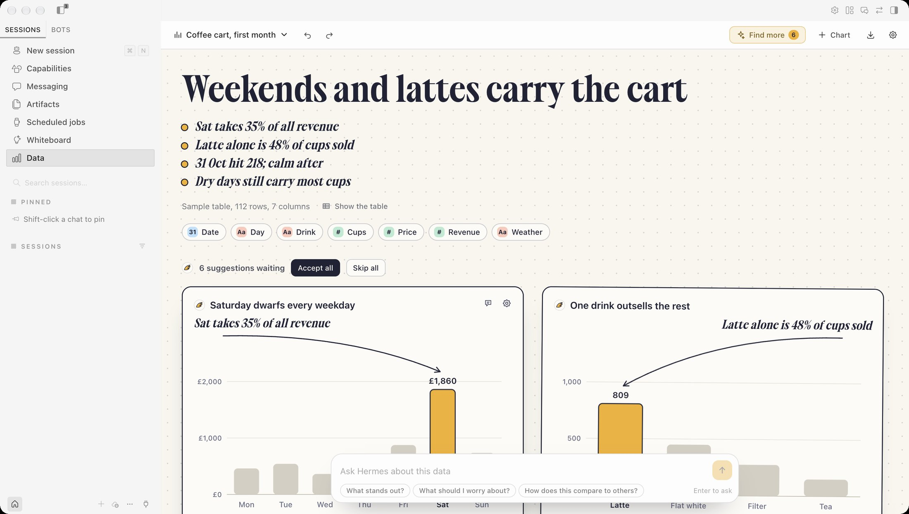
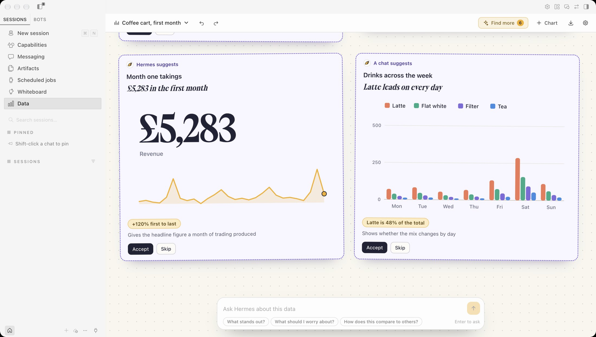
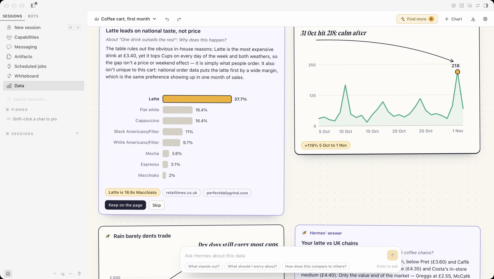

# Hermes Data

An agentic report page for [Hermes Desktop](https://github.com/NousResearch/hermes-agent). Open a spreadsheet and Hermes finds the story in it, chart by chart. You decide what goes on the page.

Part of [Hermes Folio](https://adolanium.github.io/hermes-folio/), with [Sheets](https://github.com/Adolanium/hermes-sheets) and [Whiteboard](https://github.com/Adolanium/hermes-whiteboard). Each works alone.



## What it does

- **Bring a table.** Open an Excel workbook, a CSV or a JSON file, paste rows from a spreadsheet, or drag a CSV onto the page. Data works out which columns are numbers, dates and categories.
- **Find the story.** Hermes reads the columns and a few real cuts of the numbers, then suggests a headline and three to five charts. Each chart makes one point, with a short remark and an arrow to the mark it is about.
- **You decide.** Suggestions wait beside the page with a dashed outline. Accept the ones you want, skip the rest, and undo any of it.
- **Every number is computed, not written.** Hermes picks the columns and the wording. The page adds up your rows itself. A remark can only quote a figure through a placeholder the page fills in, and a remark with a figure typed by the model is dropped.
- **Show the rows.** Every chart has a button that lists the rows behind the bar, point or slice you picked, with the working written out, for example "Sum of Cups over 28 rows = 809". Click another mark and the list follows. With Sheets installed, one click opens just those rows as a grid.
- **Ask a question.** Hermes answers with a chart. If the table cannot answer it, an agent searches the web and comes back with a small table and the pages it read.
- **Ask about one chart.** Press the speech bubble on a chart and ask why it looks the way it does. Hermes gets that chart's real numbers, and the answer lands right beside it.
- **Make it yours.** Click a bar or a point to move the highlight, and the arrow and the words beside it follow. Redraw a chart as bars, a line, an area, a donut, dots or one big number. Split it by a second column into one coloured series per value. Make it full width, reorder it, rename it, or build your own.
- **Key points.** The report opens with a short list of what its charts say. Each line is a chart's remark or its computed fact, so the summary cannot claim something a chart does not show.
- **Share it.** Export the report as a single web page or Markdown, a chart as SVG, or the table as CSV.
- **With Sheets.** When the [Sheets](https://github.com/Adolanium/hermes-sheets) plugin is on too, **Open in Sheets** opens a report's table there as a new grid, and Sheets' **Chart** button opens a grid here as a new report.
- **With Whiteboard.** When the [Whiteboard](https://github.com/Adolanium/hermes-whiteboard) plugin is on, **Pin to board** puts what each chart says on your open board as a group of notes. The words are the chart's own remark or its computed fact.
- **From any chat.** Once you allow it, a Hermes chat can read your reports, propose charts for one, or open a new report from data it gathered.





## Install

```bash
hermes plugins install Adolanium/hermes-data
```

Then switch on **Data** in Capabilities › Plugins and open it from the sidebar. It needs Hermes 0.22.6 or newer.

### More than one Hermes profile

The Data page is part of the Desktop app, so it shows in every profile and your reports are the same in all of them. Anything Hermes does from the page runs in the profile you have selected.

Opening and saving files and the chat tools go through the agent half of the plugin. Hermes installs and switches on that half for each profile separately. To use Data fully in another profile, install it for that profile as well:

```sh
hermes -p <profile> plugins install Adolanium/hermes-data
```

Then switch it on in **Capabilities › Plugins** while that profile is selected. In a profile without it, the page says its backend is not running there.

No file to hand? Press **Try a sample** for four weeks of a coffee cart.

## What it reads

- **Excel** `.xlsx` workbooks up to 8 MB. A workbook with several sheets asks which one. Dates, currency and percentage formats are kept. A formula cell gives the value Excel last saved for it. Old `.xls` files need saving as `.xlsx` first.
- **CSV**, `.tsv` and `.txt` tables up to 4 MB, with a header row. Commas, tabs, semicolons and pipes are detected.
- **JSON** as a list of records, a list of rows, or an object holding one such list.
- **Pasted rows** from any spreadsheet.
- Numbers with thousands separators, a currency sign, a percent sign or accountant's brackets.
- Dates as `2026-10-05`, `05/10/2026`, `5 Oct 2026`, `October 5, 2026` or `Oct 2026`. Day-first and month-first are told apart when the column makes it clear.
- The first 5,000 rows and 40 columns. A longer table is cut there and the page says so.

Workbooks are read by the plugin's backend with Python's standard library only. No spreadsheet package is installed, no macros run and no formulas are evaluated.

## AI, when you ask

Nothing runs until you click.

- **Find the story and Find more** each start one hidden Hermes session on your own model. It is told to use no tools. It sees the column names and types, summary numbers, up to twelve grouped totals the page worked out, and the first eight rows. It never gets the whole table.
- **Ask**, about the table or about one chart, starts a hidden Hermes session that may use your Hermes tools, mainly web search and page reading. A question about a chart also sends that chart's points. It is told not to send messages, write files, run commands or schedule anything. If it uses such a tool anyway, the answer says which.
- **Approval prompts inside these sessions are denied automatically,** because nobody could see them.
- **Budgets.** Reading a table stops after 150 seconds. An answer stops after 4 minutes or 24 tool calls. Every run has a Stop button.
- **Answer text is written by the model.** The chart under it is drawn by the page, but the sentences are Hermes' own, so check them against the chart.
- Hermes gives plugins no way to delete sessions, so these stay hidden in your session store.

Model calls apply your provider's normal usage costs.

## Privacy

```text
Your file  →  this page's storage  →  your Hermes model (a summary and eight rows, only when you ask)
                                   ↘  a copy in Hermes plugin data (only after you let chats read your reports)
                                   ↘  the web, through your Hermes web tools (only when an answer needs it)
```

- Reports and their tables live in Hermes plugin storage on this desktop.
- **Chats can read my reports** is off until you turn it on in Settings. While it is on, Data keeps a copy of each report under `plugin-data/data/` in your Hermes home: the columns, the charts and the first 400 rows. The copies live in the plugin data of the profile you are in, and each profile where Data is installed gets its own when you open Hermes on it. Turning it off deletes the copies in the profile you are in straight away, and in each other profile the next time you open Hermes on it.
- **Open and export** go through the system dialog. The page opens it with the Desktop SDK and hands the path to Data's own backend, which reads `.xlsx`, `.csv`, `.tsv`, `.txt` and `.json`, writes `.html`, `.md`, `.svg` and `.csv`, and refuses anything inside your Hermes home.
- A CSV or JSON file you drag onto the page is read by the page itself and never leaves it. A dragged workbook opens the file dialog instead, because only the backend reads workbooks.
- **Data, Sheets and Whiteboard hand things to each other inside the app window**, with a browser event between the pages, and only when you click. Nothing is written to disk for it, no backend is called and no model is involved. A table that arrives becomes a new report and never changes an existing one. Any other Desktop plugin you have switched on runs in the same window and could send or read such an event.
- No telemetry, no credentials, no shell commands or background processes of its own. The page makes no network requests of its own.

## Limits

- One table per report. There are no joins across tables.
- Charts are bars, lines, areas, donuts, dots and single numbers. A split shows at most five series, with the rest added together as "Other". There are no maps, heatmaps or stacked bars.
- Scatter charts draw at most 600 points, sampled evenly from the table.
- Chats see reports only while Hermes Desktop is running with Data switched on.
- A report holds up to 40 charts.

## Development checks

```bash
node check.mjs
node --test tests/data.test.mjs
python -m pytest tests/test_tools.py
```

`desktop/plugin.js` is one hand-written file with no build step and no bundled libraries. Charts are plain SVG drawn in that file.

## License

MIT
